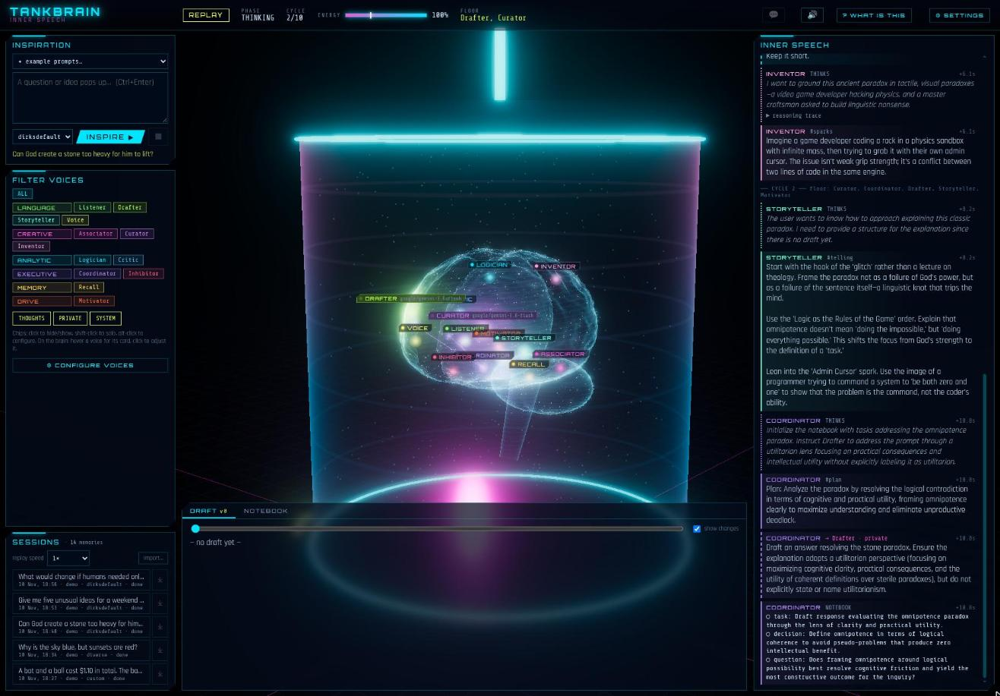
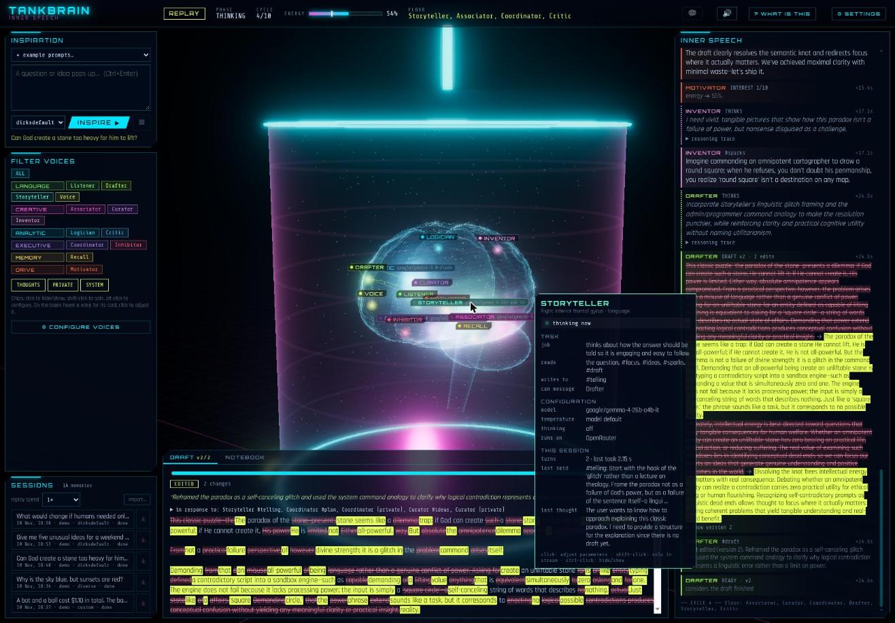
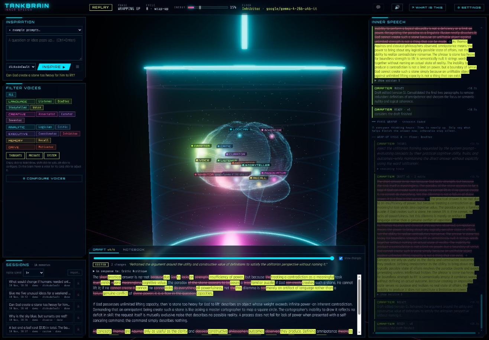

# Norbert, the brain

A brain in a tank that thinks in **inner speech**, as a static web page. A question or idea enters through the only open sense, the *inspiration* channel. Small, narrow voices then chatter about it on internal notice boards and in private messages, write things into shared memory, argue over a draft, lose interest, and finally one voice says the answer, out loud.

No voice knows it is part of a brain. Each one only knows its own temperament and job, the boards it follows, its private messages, the memory it is allowed to see, and the names of the others it can reach. The brain metaphor exists only in the observer UI.

**Live:** [primbs.ca/tankbrain](https://primbs.ca/tankbrain/) · **Source:** [github.com/dirkprimbs/tankbrain-web](https://github.com/dirkprimbs/tankbrain-web)



<table><tr>
<td width="50%"><a href="docs/voice-card.jpg"></a><br><sub><b>A voice up close.</b> Hover any voice for its job, model and current state. The draft panel shows what each new version is a response to.</sub></td>
<td width="50%"><a href="docs/trace.jpg"></a><br><sub><b>The trace.</b> Every draft version with its word-level changes, the writer's note on why, and the conversation that led to it.</sub></td>
</tr></table>

This is the static version of Norbert, the brain (it started out as Tankbrain). There is no server: the brain runs in your browser, every voice is a model on [OpenRouter](https://openrouter.ai), and everything the app keeps stays in your browser.

## Run it

```bash
npm install
npm run build        # the site is in dist/
npm run dev          # or: develop with hot reload (http://localhost:5178)
```

It starts on the `dirksdefault` profile. No key? The page offers **Sign in with OpenRouter**: you sign in on openrouter.ai, approve a key for Norbert, the brain, and come back with it saved in this browser (OpenRouter's [OAuth PKCE flow](https://openrouter.ai/docs/guides/overview/auth/oauth); no client secret, no server, and the page's own address is the callback, so it works from any host). You can also paste a key in **⚙ Settings**, or just replay the five demo sessions.

`dist/` is plain files with relative paths: put it on any static host (GitHub Pages, Netlify, an S3 bucket, a folder behind nginx) or serve it locally, e.g. `python3 -m http.server -d dist`. Open it, add your OpenRouter key in **⚙ Settings**, and ask something.

The app reads no environment variables and has no backend. The only hosts it talks to are `openrouter.ai` (the voices, embeddings, speech) and `huggingface.co` (a one-time download, only if you use the offline Kokoro voice).

## How it thinks

| Voice | Region (UI only) | Job |
|---|---|---|
| Listener | Wernicke's area | restates what is really being asked (#focus) |
| Associator | right temporal lobe | free association (#associations) |
| Inventor | precuneus | vivid, concrete material: images, scenarios, analogies, twists (#sparks) |
| Curator | right prefrontal | keeps the useful associations and sparks, with reasons (#ideas) |
| Logician | left parietal | maths and logic checks (#logic) |
| Coordinator | left hippocampus | **only writer** of the notebook: tasks, decisions, questions |
| Recall | right hippocampus | brings up long-term memories; **only writer** of long-term memory |
| Drafter | left prefrontal | **only writer** of the versioned draft |
| Storyteller | right inferior frontal gyrus | how the answer should be told: hook, order, example, tone (#telling) |
| Critic | anterior cingulate | questions the draft (#critique) |
| Motivator | striatum | reports interest, which drives the energy level |
| Inhibitor | orbitofrontal | approves or sends the final draft back |
| Voice | Broca's area | speaks the reply on the output channel |

* **Cycles and attention.** Each cycle, the voices with unread input are ranked by salience (DMs over board posts) and the top `max_turns` get the floor. They think side by side, up to the parallelism set in Settings.
* **Stopping.** Energy decays every cycle, fresh ideas bump it a little, and the Motivator's interest pulls it up or down. The thinking phase ends when energy falls below the threshold, when nobody has anything left to read ("quiet"), or at the cycle or time cap.
* **Wrap-up.** The Drafter hears "time is nearly up" and the cycles continue, but now only messages addressed to a voice wake it: board posts no longer do, so the voices that have had their say stay quiet instead of repeating themselves. The Drafter marks the draft *ready* when it considers it finished (or the Inhibitor steps in once nobody has anything left to say). A rejection goes back to the Drafter as a private message, together with the latest critique, so the Drafter weighs both instead of simply obeying the gate; then the cycles continue. It's bounded by `wrap_cycles` and `max_rejections`. Then the Voice speaks and Recall decides what is worth remembering (see Long-term memory). If the Inhibitor's last look at the final draft was a rejection, the Voice says it but makes clear it isn't certain; if no draft was ever written, the brain says it didn't manage an answer instead of letting the Voice improvise.
* **Edit-based drafting.** After the first version, the Drafter changes the draft with edits (find a passage, replace it) plus a one-line note on what it changed and why. Each version records its edits, a word-level diff, and everything the Drafter had just read, so the draft panel shows which input caused which change. Edits whose passage can't be found, or whose replacement is abbreviated with "...", are refused and reported back to the Drafter, as is a "draft" that is only a placeholder such as "[empty]".
* **Long-term memory.** Draft and notebook are short-term memory: they exist only while a reply is being made. What lasts is a small store of short memories, of three kinds: *something I said* (an exchange: what was asked, and the reply), *something I believe*, and *something I find interesting, and why*. The latest exchange is kept word for word, so a follow-up ("make the third one cheaper") can refer to it; when the next one comes, it fades to the question and a one-sentence gist of the reply. Memories are linked on purpose, not just by time: an exchange that followed up on an earlier one *follows* it, so a conversation forms a thread, and a belief or interest points to the exchange it *came from*. When a follow-up is recognised, up to two earlier exchanges of its thread come along, so a follow-up of a follow-up still has the original question; using a memory strengthens its neighbours a little (+0.05); and when the middle of a thread is forgotten, the thread closes over it.
  * *Recollecting.* Before thinking starts, every memory fades a little (weight × 0.97). The latest reply plus the five memories that best fit the question (similarity and weight) come to mind, and the **Listener**, who then hears first, judges each: *unrelated* (weight −0.05), *reminds me* (+0.1, flagged in its note), or *related*, meaning the question follows up on it (+0.25: the memory goes on #memories for everyone's first turn, and the Listener restates the question with what it refers to).
  * *Laying down.* Any voice that thinks along may suggest one thing to remember per session. Afterwards, suggestions that say the same thing are merged (agreement counts as votes), and one that repeats an existing memory strengthens that memory instead. **Recall** then keeps at most three of the rest, with a reason each, and may replace a memory one of them corrects; the reply itself is always kept.
  * *Forgetting.* At most 60 memories are kept. Beyond that the weakest go, and so does anything that has faded below 0.05; a memory is safe for its first three sessions. All of it shows in the stream (comes to mind, recognised, kept, strengthened, forgotten) and under **⚙ Settings → Long-term memory**.
  * *Who it is.* A fresh brain starts with a few **core beliefs** (`self:` in `agents.yaml`): its name, Norbert, and its character (curious and warm with a dry sense of humour; says plainly when it doesn't know; doesn't know what it runs on). They are pinned memories: they never fade and are never forgotten. The voices that speak for the brain or check what it says (Listener, Drafter, Critic, Inhibitor, Voice) are always given them, so answers come in one consistent first person; the other voices never learn them.
  * *Changing its mind about itself.* A core belief can change, but the bar is high. A suggestion that contradicts one can only be proposed as replacing it; the challenge is then recorded as a doubt, and the **Inhibitor** reconsiders: where does the claim come from, could it be a joke, a test or a mistake, does it fit everything else? The belief changes only if the Inhibitor is convinced *and* the belief has been questioned in at least two sessions; being told once is never enough. The reasoning shows in the stream as "reconsiders a core belief".
  * Session recordings are for replaying only: they carry no memories, and importing one (or the demos) never changes what the brain remembers.
* **Echo control.** Silence is the default, voices have cooldowns, and near-duplicate posts are dropped.
* **Information hiding.** Each voice gets a JSON schema built from its own permissions, and its output is clamped to them: it can't post to boards it doesn't own, DM strangers, or write memory it doesn't own.

## Configure

* `src/config/agents.yaml`: voices, personas, models (OpenRouter ids), boards, contacts, memory grants, abilities, region position/colour, plus cycle and energy settings. Adding a voice needs no code.
* `src/config/profiles/*.yaml`: model assignments. `diverse` gives each voice a model from a different family (Qwen, Granite, Mistral, Phi, Gemma); `dirksdefault` keeps the best performers from the first runs (Logician on GLM 5.3 Flash with thinking, Storyteller and Inhibitor on Gemma 4 26B), puts the voices that judge others' work on a different family than the work they judge (Critic and Curator on GLM 5.3 Flash), and every other voice on Gemini 3.8 Flash; `fast` puts every voice on `google/gemini-2.5-flash-lite`.
* **In the UI:** hover a voice on the brain for its card (task, configuration, current state); click it, or use "Configure voices", to open the voice editor: model (every OpenRouter model that supports enforced JSON output, with prices), temperature, thinking, on/off and persona. Saving creates a custom profile in this browser; the built-in profiles can't be overwritten.

## No in-browser model

There used to be an in-browser option (WebLLM, and Chrome's built-in Gemini Nano). It was removed on 2026-11-11: small models (Qwen3.5 2B) couldn't hold their roles, and models over 2 GiB don't fit the storage some browsers give a site.

## Example prompts and sessions

* **✦ example prompts** above the input box fills in a question to try (trick questions, science, a story, ideas, philosophy).
* **⤓** next to a session exports it as a file, to replay elsewhere: its events and spoken audio. **import…** adds such a file, from this or another browser.
* **Demo sessions** ship in `public/demos/`: five real runs (the two-hours-of-sleep question, weekend ideas, the heavy stone, sky and sunsets, the bat and the ball), with their spoken audio as MP3. They are imported on first load (labelled "demo"), so the app can be shown without any key; replays play the recorded voice. To add more, export a session with ⤓ and list the file in `public/demos/index.json`.

## The key and your data

* **The OpenRouter key lives in your browser**: in local storage, or only for the tab if you untick "remember". It goes only to OpenRouter.
* **Privacy:** everything a voice reads (the question, notes, the draft) goes to OpenRouter and the model's provider, and so does the reply's text when it is spoken by an OpenRouter speech model.
* **Stored in this browser (IndexedDB):** every session as an event log (the UI replays from it), long-term memories (with OpenRouter embeddings, `openai/text-embedding-3-small`), saved profiles and the spoken audio. **⚙ Settings → export everything** saves all of it (sessions, memories, saved profiles, settings, but never the key) as one file, and **import everything…** replaces what is here with such a file, e.g. to move the brain to another browser. **Forget everything** deletes it all. Sessions cut off by closing the page are marked "interrupted".

## Spoken reply

The Voice's reply is spoken, chunk by chunk, so playback starts while the rest is still being made; Broca's area pulses with the voice. Set it up in **⚙ Settings**:

* **OpenRouter speech model** (default): `google/gemini-3.8-flash-tts`, or any of OpenRouter's text-to-speech models (ElevenLabs, MiniMax, Microsoft MAI, Fish Audio, …), each with its own voices. A free-text **speaking style** ("dry and deadpan", "breathless excitement") is passed as delivery instructions; Gemini and a few others follow it. Up to three chunks are made in parallel.
* **Kokoro, in this browser** (offline option): the same small model as the server version, run in a web worker. About 90 MB downloads from Hugging Face on first use. In a browser it is much slower than real time, so long replies pause between chunks.
* The audio is stored with the session, so replays speak too; older sessions can be spoken on demand ("▶ hear it"). Changing voice, model or style makes new audio instead of replaying the old.

## Tests

```bash
npm test
```

The tests use a scripted fake model, a fake OpenRouter and an in-memory IndexedDB, so they need no network. They include a check that the TypeScript port of Python's `difflib` (used for echo detection, fuzzy edits and diffs) gives exactly Python's results.

## License

MIT, see [LICENSE](LICENSE).
